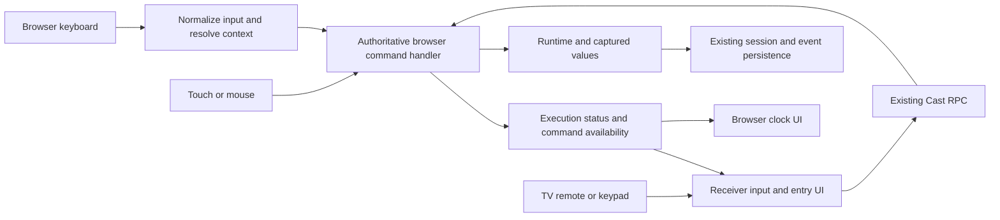

# Clock command controls

Status: implemented in the `clock-command-board` worktree. Physical Chromecast, Bluetooth keypad and mobile OS delivery still require hardware acceptance.

## Decision

Make the clock a command board on desktop, mobile browsers and the Cast receiver. Keep the existing Stop / Pause / Next controls and timer tiers. Add a visible rep count, a compact key legend and one shared value-entry flow. The TV remote navigates and clicks; a numberpad sends direct commands.

The browser remains the execution and persistence authority. A receiver command must obey the same rules as a browser click. Pairing a Bluetooth device is an operating-system task, not a Web Bluetooth feature.

## Review baseline before implementation

| Screen | Current controls and navigation | Gap for this feature |
| --- | --- | --- |
| TV preview | Workout list; arrows move spatial focus; Select starts the focused workout | No target-entry screen on the receiver; selection sends an array index rather than stable workout identity |
| TV active clock | General timer layout; initial focus on Next; arrows reach Pause, Stop and the clickable clock; Select activates focus | No numberpad commands or rep count; pause state is not synchronized; Next can bypass the browser's paused gate |
| TV review | Summary cards and a focusable Dismiss button | Intentionally read-only today; no actual-value entry |
| Browser Detail | Clock, stack/audit panel, Stop / Pause / Next; clickable clock toggles playback | Enter / Volume Up shortcut is conditional on track view and mounted TimerDisplay; it is not a shared command contract |
| Browser Minimal / General | Same core controls; mobile supports swipe-left Next and swipe-right Stop | No shared keyboard listener, so numberpad Enter can activate whichever button holds focus |
| Pre-run collection | CollectionWizard presents choices and free-text values | Choices affect compilation; numeric answers only populate display overrides; no Enter-submit contract |
| Post-run collection | Wizard presentation exists | No production post-run caller; last post-run item has no Save affordance; grid overrides are not persisted result corrections |

The timer tier decision remains unchanged: Minimal below 500px, General from 500px, Detail from 900px; receiver always General. Input capabilities must not depend on those sizes.

### Observed before implementation

Exercised the running app on port 5174 at 1440×1000 and 375×812, plus its local receiver popup:

- Desktop focused Next + Enter advances the workout.
- Mobile Minimal focused Pause + NumpadEnter pauses instead of advancing. This is native focused-button activation, not numberpad command handling.
- Opening the fullscreen clock leaves DOM focus in the underlying CodeMirror editor. The dialog prevents body scrolling but does not establish modal focus ownership.
- Receiver ArrowLeft from Next focuses Pause; Enter pauses the browser. The receiver still labels the control Pause and keeps Next enabled.
- Receiver ArrowRight + Enter while paused advances and completes the sample workout, despite the browser disabling Next.
- A later local-popup attempt failed its five-second handshake. Local-popup proof is not a guarantee of reconnect reliability or real-device input delivery.

The `?` collection and persistence findings below are source-reviewed, not an exercised end-to-end value-saving claim. No physical Chromecast, Bluetooth numberpad, iOS or Android hardware was tested.

## Input rules

### Remote navigation and command keys are different

- Arrows move focus. Remote Select clicks the focused enabled control exactly once. It never means Next unconditionally.
- Recognizable numberpad Enter means the clock's primary command, regardless of which ordinary clock button was last clicked. During a running workout that command is Next.
- Main-keyboard Return means the primary command when the clock command area itself owns focus. On a focused button or form control it keeps native activation/submission behavior.
- Entry dialogs and confirmation dialogs take priority over workout shortcuts. Confirming a value cannot also advance a workout.
- Prefer `code === 'NumpadEnter'` or `location === 3` to identify the keypad. Use `key` for printable digits/operators and `code` for known physical keypad fallback.
- Some devices expose remote Select and keypad Enter as identical generic Enter events. Do not guess device identity. Offer a per-device-page Controls setting, Navigation or Keypad, and a small key-check screen. Keypad mode interprets ambiguous Enter as the primary command. Navigation mode interprets it as focused selection. Explicit Select/Center events always remain selection. Simultaneous indistinguishable Enter sources cannot have different guaranteed meanings.

### Numberpad layout

| Key | Live clock, no entry open | Value-entry card |
| --- | --- | --- |
| Enter | Next; disabled while paused; at Ready, explicitly starts the workout | Validate and commit this field, then show the next field; final field leads to Ready or review, not an implicit workout step |
| `+` | Add one actual rep to the displayed rep target | No rep command; do not alter another field |
| `-` | Remove one actual rep, minimum zero | No rep command; signed values only if the field's domain permits them |
| `8` / `2` / `4` / `6` | Move focus up / down / left / right with Num Lock on or off | Enter digits as data |
| Other digits | Begin actual-rep entry for the selected movement | Append digits to the draft |
| `.` or decimal separator | Begin decimal entry only when the selected field permits it | Decimal separator for decimal metrics; no effect on integer reps |
| `*` | Open Values: unresolved fields and editable current actuals | No implicit save, skip or target change |
| `/` | Start, pause or continue according to execution state | No playback command while editing |
| Backspace / Clear | No workout mutation | Remove a digit / clear the draft |
| Escape / remote Back | Open Stop-and-save confirmation during a live run | Cancel this draft and return to the previous screen |
| Tab / Shift+Tab | Normal browser focus navigation | Move through controls without silently discarding an edited draft |
| Num Lock | No command | No command |

Direction digits never mutate the workout. Open Values with `*` or its button before entering a number containing 8/2/4/6. Every digit is data inside value entry. Choice prompts may use numbered options; Enter confirms the selection.

A short numberpad without Escape or Backspace can reach Cancel, Clear and Stop via the visible controls. Do not require function keys, long presses or modifier chords.

### Safety and focus

1. Only the foreground clock owner handles commands. A fullscreen clock supersedes inline clocks. Unrelated editors, search, menus and form fields retain their keys.
2. On opening the clock, save prior focus and move focus into it. Use modal semantics and contain focus while fullscreen; restore prior focus on exit. Never leave an underlying editor active.
3. One keydown produces at most one mutation. Ignore held-key repeats for Next, rep adjustments, playback and confirmation. Digit editing may repeat. Respect composition and Ctrl/Alt/Meta shortcuts.
4. Consume only recognized, owned commands. Suppress the native click for a consumed numberpad Enter, not for every Enter on the page.
5. Stop requires confirmation and preserves partial results. Backspace edits numbers; it no longer stops a workout. Browser history and OS Back are only interceptable where the platform delivers an application event.
6. Disabled means disabled at the authoritative command handler as well as in the UI. Paused Next, required-timer skip restrictions and completed-run commands cannot be bypassed by RPC.
7. Media Play/Pause controls playback, not the focused button. Do not rely on volume keys for portable control; retain device-specific support only where events are actually delivered.

## Screen changes

### Before the workout

TV preview continues to select a workout with the remote. Selection opens collection when required, rather than silently defaulting values and starting.

Reuse CollectionWizard's one-field-at-a-time presentation on browser and receiver. Each card shows the movement, metric name, unit, target versus actual, round/set when applicable, and progress such as `2 of 4`. Every field, including the last, has an explicit Save action.

- A value that determines execution, such as a timer duration or loop count, must resolve before Start. Missing execution values block Start with a field-specific explanation.
- A value that records performance, such as actual reps completed, can be deferred to after the workout. It must not be converted into a planned target merely because it uses `?`.
- Target versus actual is explicit in the collection model and UI, not inferred from entry time or `?` alone. Keep existing workout syntax; carry the selected intent in the run's captured values.
- Plan answers affect the run's statements before compilation and are recorded with that run. Do not rewrite the original workout note as a side effect.
- After the last answer, show a Ready screen. Enter then starts. A held Enter cannot confirm the last field and start the timer in one press.

### During the workout

Keep the clock dominant. Place a stable count below the movement, for example `Actual reps 12 / Target 20`, with visible `−` and `+` buttons. Put a compact command legend beside the existing control area. Do not add a second timer navigation bar.

- First `+` starts an explicit actual count at one. An uncounted movement is unknown, not zero; a recorded zero is distinct.
- Count belongs to the current movement occurrence, including its round/set, not the session total or parent loop.
- One active movement gets selected automatically. A grouped block with multiple movements shows a target selector before the first rep change. Never credit all movements at once.
- Count can exceed a planned target and can operate without a known target. Target achievement does not auto-advance. Next remains the transition command.
- Once counting begins, Next records the entered actual count, even if below target. Preserve existing uncounted completion behavior, but keep inferred/planned values distinguishable from measured user actuals.
- Non-direction digits open an actual-value card rather than replacing the counter immediately. `1`, `5`, Enter sets 15 without advancing. Use Values first for direction digits.
- Opening entry does not silently pause time. Show running/paused status. An automatic segment transition must not retarget a draft: commit to its pinned occurrence, or reject a stale/invalid target with the draft intact.

For the TV, use a large entry card and on-screen numeric grid reachable by D-pad, plus Save, Clear and Cancel. This also lets the remote complete collection without a keyboard. Mobile uses the same field model with an accessible input and appropriate `inputmode`; do not autofocus a text input on the live clock and summon the phone's software keyboard.

### After the workout

Save the timed run first. Present missing actuals as an ordered collection queue on both browser and TV before dismissing the clock. Allow Skip for optional actuals, keeping them missing rather than writing zero.

Each Enter commits one answer. The last answer returns to review with a visible Saved state only after persistence succeeds. Dismiss closes review; it does not invent missing answers or restart the workout. If the browser host navigates to a session-detail route at completion, that destination owns the same collection queue and remains connected to the TV's collection state.

A save error keeps the field and draft available for retry. Result corrections survive reload and analytics recomputation. Rep count, edited actuals and pre-run plan values must not remain solely in the display-override store.

### Value validation

- Reps and rounds: nonnegative integers; execution loop counts follow the runtime's positive-count rules.
- Load/distance: finite values with the field's unit and domain limits. No unit-changing keyboard command; use the visible unit selector.
- Duration: show an explicit minutes/seconds editor so a numberpad need not type a colon. Never interpret `130` as either 130 seconds or 1:30 without a visible format. Validate seconds in 0–59.
- Reject invalid/empty values without advancing. Zero is valid only where the field permits it. Preserve the draft on error.

## Implementation placement

Reuse the existing timer layouts and Cast transport. Add one shared command policy at the active clock-session owner, not listeners inside Minimal, General and Detail separately.

The command set is small: Next, Start/Pause/Continue, Stop request/confirm, Adjust reps, and Commit value. Local draft editing stays local to the entry UI. Reuse existing `next/start/pause/stop` events where their meaning fits; add typed payload-bearing rep/value commands rather than disguising them as Next.

Receiver and browser display the same authoritative execution status, command availability, current occurrence and collection target. Remote commands identify the run and specific occurrence/field, not a label or array position. The sender validates payloads, target identity and command availability before applying a mutation. Receiver disconnected means controls unavailable with a visible explanation, not a local success animation. Do not queue or automatically replay mutations across disconnects; use fresh authoritative state after reconnect.

| Existing location | Change |
| --- | --- |
| `components/organisms/editor/RuntimeTimerPanel.tsx`, `panels/track-panel.tsx`, `stores/workbenchSessionStore.ts` | Attach input once to the active clock owner; share command gates and actual-rep state across inline, fullscreen and workbench runtimes |
| `components/organisms/workout/TimerCore.tsx`, `TimerSurface.tsx`, `TimerStackView.tsx` | Render rep count, Values and key hints; route clicks through the same commands; keep tiers presentational |
| `panels/wallclock-panel.tsx` | Remove the old per-display hardware listener when the shared input owner takes over |
| `hooks/useSpatialNavigation.ts`, `app/receiver-rpc.tsx` | Preserve remote selection, distinguish keypad commands, scope modal navigation, stop double dispatch, forward command data |
| `panels/wallclock-panel-chromecast.tsx`, `services/cast/rpc/*`, `components/organisms/cast/CastButtonRpc.tsx` | Synchronize execution/collection state; add payload-aware routing and sender-side gates |
| `hooks/useCollectionMetrics.ts`, `components/organisms/review/CollectionWizard.tsx` | Stable field identity; target/actual intent; numeric validation; Enter-save; explicit final Save; pre/post-run use |
| `components/organisms/review/FullscreenTimer.tsx`, `app/pages/WallClockPage.tsx` | Preserve post-run collection through completion, saving and route changes |
| Runtime metric/output handling and existing result persistence | Record user actuals on the executed occurrence; persist plan answers and corrections; recompute summaries with user-value precedence |

Do not wire directly to EffortBlock merely because it has an increment method. It is not constructed by production compiler strategies, clamps to a known target and cannot represent open-ended actual counting. Put counting on the execution path the clock actually uses. Reuse its logic only if it fits that path without a second competing counter.

For persisted corrections, follow the existing user-origin event and analytics-rederivation pattern, but make replacement atomic and target a specific occurrence. The existing RPE helper is a precedent, not a drop-in implementation for arbitrary metrics. Keep source revisions immutable and do not store corrections by segment display name.

## Delivery order and acceptance

1. **Shared commands and focus.** Browser, mobile-size clock and local receiver invoke the same gated Next/playback/Stop commands. Remote Select operates focused controls; paused Next is rejected at the sender; receiver shows Continue and disabled Next. Test modal focus, underlying editor isolation, held keys and single dispatch.
2. **Actual rep counting.** `+ + -` records one actual rep; count follows one occurrence through Next and reload. Cover unknown target, over-target count, explicit zero, grouped movements and a new round resetting only the new occurrence's count.
3. **Collection and persistence.** Browser and receiver fill the same pre-run and post-run fields. Enter never saves and skips simultaneously. Cover a single final field, validation failure, optional Skip, required execution value, decimal load, duration, repeated movement names, save failure and analytics rederivation.
4. **Hardware acceptance.** Run the complete workout flow on Chromecast with Google TV / Google TV Streamer using its remote, then a paired numberpad; repeat on desktop and physical Android/iOS browsers with Bluetooth keyboards. Record delivered `key`, `code`, `location` and repeat behavior in the key-check screen, including Num Lock on/off, keyboard sleep/reconnect and ambiguous Enter fallback.

Browser automation covers desktop/mobile layout and the local receiver RPC path; it cannot establish Bluetooth HID delivery, TV OS interception, iOS Safari keyboard behavior or sender survival in the background. The Cast receiver remains dependent on the sender. Autonomous TV execution is outside this design.

## Verification

`bun run test` passes: 1,977 package tests, 2,912 playground tests and 125 Storybook tests. Both `bun run build:app` and `bun x vite build --config apps/playground/vite.receiver.config.ts` pass.

Exercised desktop and 375×812 clocks plus the local receiver. `+ + -` records one actual rep; entry accepts direction digits as data; receiver changes update the sender; Stop confirmation preserves the run into saved review. Pre-run target entry leads to Ready before a separate Start. Post-run entry saved 9 reps on an occurrence and retained that correction after reload.

The journal, editor, run route, home tour and syntax examples keep the captured result ID through review. Normal completion retains the fullscreen review until dismissal; host-requested tour restarts still finish their pending action. Saving a post-run correction reloads the review from persisted events instead of leaving the old target-only row onscreen.

The receiver exposes an explicit, focused Start Workout action after collection. Its command board stays inside the viewport in preview and review modes.

The shared Next button keeps its fixed touch height instead of shrinking inside the vertical caption column. Direct browser checks at 375×812 and 812×375 found all three controls reachable without scrolling, with Stop at 48px and Pause/Next at 54px high. Pausing changed the control to Continue and disabled Next.

Focused regression checks passed 381 tests across 40 files. After integrating the current main branch, the command-board, Cast round-trip, collection and updated home-tour acceptance run passed all 19 scenarios with no retries, including 375×812, 812×375 and 1440×1000 home clocks. Receiver entry saved the actual as 9 reps, the review displayed it beside the planned 7, and the saved correction survived reload. `bun run build:storybook` and the receiver production build passed before this integration; General and Minimal stories were rendered and inspected.

After integrating main, the playground unit run passed all 2,932 tests across 301 isolated files. The full playground TypeScript check still fails on existing diagnostics. The newly exposed collection-fixture metric type was corrected; no clean full-app typecheck is claimed.

Run acceptance against a fresh dev server after seed generation finishes. Regenerating `public/seed` under an existing Vite server was observed to make manifest requests return HTML, failing the seed gate before clock assertions.

Put Playwright output outside the repository with `--output=/tmp/wod-clock-acceptance`. In-repository screenshot and trace writes triggered repeated Vite CSS updates during acceptance; a captured blank-page failure reported duplicate `createRoot()` and `removeChild` errors during those updates.

The main-branch home redesign retains its editor and result sections. Completion keeps the saved fullscreen review open; dismissing it glides to the insights section. Focus restoration uses `preventScroll` so returning focus to the editor cannot override that glide. The integrated path was exercised in the browser and the home acceptance suite.

The pre-main integration of #1082, #1083 and #1084 passed 1,993 package tests, 2,931 playground tests and 124 Storybook interaction tests. Package lint and typechecking, playground/Storybook/receiver builds, relocated CLI hosting and all 18 Storybook acceptance scenarios passed. The production browser check confirmed mobile Pause disables Next and Stop retains the saved fullscreen review. Physical Cast/keypad delivery remains outside browser coverage.

The PR verification comment waits for package, playground, Storybook and both deployed E2E jobs. A failed package or E2E job now prevents the comment from reporting verification passed.

Production-bundle Cast acceptance explicitly sets `localStorage['wodwiki.castBackend'] = 'local'` before sender startup. This opt-in exercises the real popup receiver and RPC transport without a physical TV; the default production backend remains Chromecast. All four local receiver scenarios passed against the production build, including paused Next rejection and numeric rep entry.

Integration acceptance follows Stop confirmation through the saved review before dismissing the clock. Catalog fixtures use the real seed compiler and intercept worker requests at the browser-context level. A production worker smoke imported only the selected CrossFit Games chunk, not the adjacent Girls package. CLI skills discovery also passed through a `node_modules/.bin` symlink.

Final local checks passed 1,994 package tests, 2,931 playground tests and 124 Storybook tests, with existing package expected failures/skips unchanged. All 18 Storybook acceptance scenarios passed. Landscape home checks dismiss completed sync notifications before hit-testing controls; toast viewport padding is click-through while notification cards remain interactive. Equipment clone acceptance compares the original body with the copied body instead of pinning external catalog wording.

Background registry refresh keeps the hydrated registry ready instead of unmounting the editor behind a loading state. This prevents a seed-import broadcast from discarding a new effort's uncommitted label. The catalog create acceptance sends a broadcast during label editing; the original production bundle failed with an empty label.

Post-integration acceptance exposed stale effort details after seed hydration and missing blur/line-change save callbacks on effort and equipment pages. Hydration revisions now re-resolve effort details and equipment links without replacing active editor drafts. Both content hooks return the save callbacks already consumed by their pages. The equipment helper blurs after editing so persistence checks exercise the intended save policy. Targeted catalog checks passed 23 scenarios with two existing skips; all five receiver and numeric-collection checks passed when the local preview included the dedicated receiver build.

## Evidence

- [Timer tier decision](adrs/0003-timer-surface-tiers.md), especially input scope in §4.
- [TimerSurface](../apps/playground/src/components/organisms/workout/TimerSurface.tsx), lines 45–114; [TimerCore](../apps/playground/src/components/organisms/workout/TimerCore.tsx), lines 202–311.
- [Browser hardware shortcut](../apps/playground/src/panels/wallclock-panel.tsx), lines 410–446; [FocusedDialog](../apps/playground/src/components/molecules/FocusedDialog.tsx), lines 43–91.
- [Receiver navigation and dispatch](../apps/playground/app/receiver-rpc.tsx), lines 75–183, 516–531 and 593–600; [receiver pause model](../apps/playground/src/panels/wallclock-panel-chromecast.tsx), lines 28–42.
- [Cast command router](../apps/playground/src/services/cast/rpc/eventRouter.ts), lines 25–59; [sender routing](../apps/playground/src/components/organisms/cast/CastButtonRpc.tsx), lines 117–149.
- [Collection model](../apps/playground/src/hooks/useCollectionMetrics.ts), lines 64–149; [CollectionWizard](../apps/playground/src/components/organisms/review/CollectionWizard.tsx), lines 44–75 and 210–253; [pre-run save wiring](../apps/playground/src/components/organisms/editor/RuntimeTimerPanel.tsx), lines 219–247 and 522–540.
- [Display-only override hook](../apps/playground/src/components/organisms/review/useUserOverrides.ts), lines 37–88; [persisted RPE precedent](../apps/playground/src/services/analytics/captureSessionRpe.ts), lines 39–117.
- [EffortBlock count contract](../packages/lang/src/runtime/blocks/EffortBlock.ts), lines 158–213; [completion save and navigation](../apps/playground/app/pages/WallClockPage.tsx), lines 56–77.
- [Google Bluetooth pairing instructions](https://support.google.com/chromecast/answer/14632555?hl=en) describe system pairing, not guaranteed keyboard delivery into a Cast Web Receiver. [Android TV controller guidance](https://developer.android.com/training/tv/get-started/controllers) describes native TV input expectations, not a Web Receiver guarantee.
- [KeyboardEvent.location](https://developer.mozilla.org/en-US/docs/Web/API/KeyboardEvent/location) and [KeyboardEvent.code](https://developer.mozilla.org/en-US/docs/Web/API/KeyboardEvent/code) explain keypad identification. Confirm actual delivery on the supported device matrix.

Deferred: configurable shortcut maps, macros and autonomous receiver execution. Add only for demonstrated device or workout requirements; none is needed for this command board.
