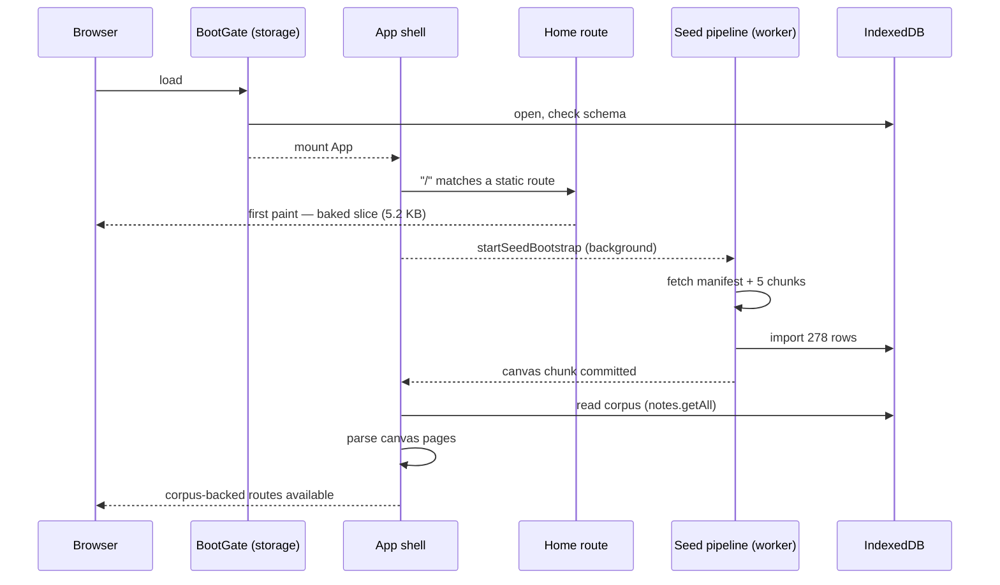

# Playground Home Cold Boot — decoupling the home route from the seed pipeline

**Status:** Proposed
**Date:** 2026-10-24
**Related:** `docs/reviews/wod-wiki-ux-regression-retest-2026-10-25.html` (issue #1 — *Cold start takes 34 to 35 seconds with no honest progress*), `docs/prototypes/seed-data-unification.md` (§ Risks & open questions → *First-load network dependency*), `docs/adrs/0002-catalog-source-lifecycle.md`, `apps/playground/app/App.tsx`, `apps/playground/app/main.tsx`, `apps/playground/src/services/seed/seedReadiness.ts`

## Goal

`/` must render a usable home page **without the seed corpus**. The seed pipeline keeps running — but in the background, where it belongs. The home page stops being a view onto imported data and becomes a page the bundle owns.

Why now: the 2026-10-25 retest measured a 34–35 s cold start against a 5 s budget. The board's prescription — label the phases, add marks, then optimize what the marks prove dominant — is right but not sufficient: **the home route cannot render at all until the corpus is fetched, imported, read back, and parsed.** Labelling a 34-second spinner does not make it usable. The structural fix is to remove the dependency, then narrate what remains.

This document is the *review decision* the seed design asked for. `docs/prototypes/seed-data-unification.md:173` — *"First-load network dependency … (a) embed a small bootstrap chunk (home + getting-started, ~tens of KB) — keeps first paint offline-safe, recommended; (b) block on full import with a loading route — simpler, worse UX. Decide in review."* Option (b) shipped. This document decides (a), scoped to the home route, and specifies how.

## Context — what the first paint actually waits on

Two gates, in sequence.

**Gate 1 — storage readiness** (`apps/playground/app/main.tsx:23-61`). `BootGate` awaits `whenStorageReady()` (`src/services/storage/index.ts:138`) before mounting `<App />`: schema-version check, IndexedDB open, default tag-type seeding. Local only, no network; it renders `Loading…` (`main.tsx:53-58`). This gate stays — the home page needs IndexedDB for user data (sessions, notes) even when it does not need the corpus.

**Gate 2 — the corpus gate** (`apps/playground/app/App.tsx:170-178`). `/` has **no route of its own** in the route table. It exists only as a canvas route derived from the seeded corpus (`app/canvas/canvasRoutes.ts:26-48`). Until the corpus lands, the wildcard route renders `RootUnavailable`: `Loading library…` while `seedReadiness === 'preparing'`, otherwise a "Re-seed library" error card (`App.tsx:113-139`).

The chain behind gate 2 on a fresh browser:

| # | Step | Where |
|---|---|---|
| 1 | `startSeedBootstrap()` — no core checkpoint → gate → `preparing` | `seedReadiness.ts:150-183` |
| 2 | fetch `manifest.json` + 5 chunks over HTTP | `seedSync.ts:269-345`, `seedSources.ts:74` |
| 3 | worker parses the chunks, writes 278 rows into IndexedDB | `seedSync.worker.ts`, `SeedImporter.ts` |
| 4 | canvas chunk commits → `onFirstPaint` → readiness `ready` | `seedSync.ts:331-332`, `seedReadiness.ts:82-110` |
| 5 | **main thread** — `getSeedContent()` = `notes.getAll()` over the whole notes store, filtered to seed rows | `StorageService.ts:999-1003` |
| 6 | **main thread** — `buildCanvasRoutes()` parses every canvas page | `canvasRoutes.ts:26-38`, `parseCanvasMarkdown.ts` |
| 7 | `/` appears in the route table → the wildcard stops gating | `App.tsx:170-178` |

Steps 5 and 6 are the part the current design cannot avoid: the corpus is read as one map and parsed as one batch, so any corpus-backed route pays for all of it.

**What the home page actually needs from that pipeline: 8 files, 5,215 bytes.**

| Slice | Rows | Bytes | Home needs it? |
|---|---:|---:|---|
| home slice — `markdown/canvas/home/README.md`, `markdown/canvas/home/welcome-1.md`, 6 demo documents | 8 | 5,215 | **yes** |
| canvas chunk (whole) | 87 | 299,322 | no — 8 of 87 |
| core seed (5 chunks) | 278 | 442,540 | no |
| `manifest.json` | 1 | 121,179 | no |

Measured from `apps/playground/public/seed/core/manifest.json` (version 2947) and the canvas chunk's row contents.

**The dependency is almost entirely accidental.** The home page is already hardcoded React. `HomeView` (`app/views/HomeView.tsx:27-39`) discards everything the parser produced except `page.quests` and renders `HomeTour` (`app/tour/HomeTour.tsx`, 697 lines) — hero, editor demo, chapter list, insights sections, footer are all React. The parsed markdown contributes quests; the demo documents contribute the editor's arrival script (`HomeTour.tsx:60,71-73` → `canvasUtils.ts:13-57`). The route exists to serve content the bundle could have carried.

## Design

### D1 — `/` is an explicit route

`App.tsx` gains a static `<Route path={ROUTE_PATTERNS.home} element={<AppContent … />} />` ahead of the wildcard. The corpus stops contributing a `/` route in one place — `buildCanvasRoutes` skips the home page (`canvasRoutes.ts:26-38`) — so the route table holds no `/` and the app has exactly one. The wildcard keeps gating exactly the paths that genuinely need the corpus.

Because the home page is no longer in the route table, `useFindCanvasPage('/')` returns `null` once the corpus lands too; the home page resolves from the baked slice on both sides of the import (D2).

### D2 — the home route is its own page kind

`routeView.ts` classifies `/` as a new page kind `home` **before** the canvas branch (`routeView.ts:291`), so classification no longer depends on `canvasPage` being non-null. The `home` kind reuses the canvas shell configuration verbatim (`wrap: 'canvas'`, `withIndex: true`, `actionsMode: 'collection-readonly'`, `routeView.ts:300-310`) so the chrome does not move. `deriveNav` returns `[]` for `/` regardless of the corpus (`routeNav.ts:45-51` — the home tour owns its own L3 outline).

`HomeView` resolves its page from the baked slice instead of `useFindCanvasPage('/')`. The route still renders through `AppContent`, so the challenge badge, breadcrumb, and page actions keep their current wiring; the badge's quest list comes from the baked page (`AppContent.tsx:334-338`).

### D3 — the home slice is baked into the bundle

New module `apps/playground/app/canvas/homeSlice.ts`:

```ts
import homeMarkdown from '../../../../markdown/canvas/home/README.md?raw'

export const HOME_PAGE: ParsedCanvasPage = parseCanvasMarkdown(homeMarkdown)
export const HOME_DOCS: Record<string, string> = {
  'markdown/canvas/home/welcome-1.md': '…',
  'markdown/canvas/syntax/single-movement.md': '…',
  // …the remaining demo documents the home page references
}
```

- `?raw` imports are already the repo's way to bake content into the bundle (`app/templates/defaultPlaygroundContent.ts:1`).
- The browser build cannot read files at runtime: `fs` / `node:fs` are aliased to an empty shim (`vite.config.ts:135-136`). Everything content-shaped must be baked.
- `parseCanvasMarkdown` is pure and already runs outside Vite (`app/canvas/canvasRoutes.test.ts:6,10` imports it under `bun:test`), so the parse can happen at module load: one 3.7 KB document, once, before first paint.
- Bundle cost: 5,215 bytes of markdown. The parse result is a small object (quests, chapters, scroll stages).

The slice's file list is derived from the home page itself — the `source:` of every scroll stage plus the arrival document — and a parity test asserts each referenced source resolves inside `HOME_DOCS`, so a new stage cannot ship without its document.

### D4 — the corpus stops owning the home route, and keeps running

The seed pipeline is unchanged: fetch → worker import → IndexedDB → corpus read-back → tag index → registries. It becomes strictly background work for the home route. The seeded `markdown/canvas/home/README.md` row stays in the corpus for now and becomes inert for routing; phase 3 removes it from the compiled chunk (the seed compiler needs an exclusion rule, and its parity gate the matching update).

Because the bundle and the seed are compiled from the same `markdown/` tree in the same build (`apps/playground/package.json` build script runs `sync-seed.ts`, then `vite build`), the baked slice and the seeded row cannot disagree in a same-build deployment. A seed republished without an app redeploy can lag the bundle; the bundle wins, and the difference is a content-only change to the home page.

### D5 — the gate that remains reports the truth

Deep links into corpus-backed surfaces (`/guide/*`, `/journal`, `/feeds`, `/catalogs`) still wait for the corpus. That gate keeps the board's prescription, with the labels that already exist (`TourJumpSection.seedProgressLabel`, `TourJumpSection.tsx:94-105`) and the marks the board asked for — `seed:start`, `home:first-paint`, `corpus:ready`, `seed:settled` — echoed onto `document.documentElement.dataset` beside the existing `data-seed-state` / `data-seed-outcome` (`seedReadiness.ts:43-54`).

### Boot sequence after the change



### Alternatives considered

| Option | Outcome | Verdict |
|---|---|---|
| **Bake the home slice into the bundle (this document)** | Home renders with zero corpus dependency; the markdown stays the source of truth | **Chosen** |
| Embed a bootstrap chunk in the seed (seed-data-unification option a) | Same outcome, but the home content travels through the seed compiler and ships twice | Rejected — a second owner for the same markdown, plus a parity gate to maintain |
| Hardcode the home page as TS constants | Fastest to build; forks the home content away from `markdown/` | Rejected as the primary shape; kept as the fallback if the bake cannot ship |
| Keep the gate, label the phases | Honest, but the 5 s Home budget still fails | Rejected as insufficient — a labelled 34 s spinner is not a usable home |
| SSR / SSG the home | — | Rejected — deployment is static (GitHub Pages); there is no server |

## Change surface

| File | Change |
|---|---|
| `apps/playground/app/canvas/homeSlice.ts` (new) | Baked home page + demo documents |
| `apps/playground/app/lib/routeView.ts` | New `home` page kind; `/` classified before the canvas branch |
| `apps/playground/app/lib/routeNav.ts` | `/` returns an empty index with or without a corpus |
| `apps/playground/app/App.tsx` | Explicit `/` route ahead of the wildcard |
| `apps/playground/app/views/HomeView.tsx` | Resolve the page from the slice; merge `HOME_DOCS` into `wodFiles` |
| `apps/playground/app/AppContent.tsx` | Home badge accessory from the baked quests |
| `apps/playground/app/canvas/canvasRoutes.ts` | The corpus no longer contributes a `/` route |
| `apps/playground/app/canvas/canvasRoutes.test.ts` | Governance flip (Risks §4) |
| `apps/playground/src/services/seed/seedReadiness.ts` | Boot marks + phase labels for the remaining gate |
| `packages/tools/src/seedbuild/*` (phase 3) | Exclude the home rows from the compiled chunk; update the parity gate |

## Acceptance

1. Fresh production profile, empty site data, disabled cache: the home route renders the hero, the editor demo, and the chapter list **without the corpus** — the seeded home page is not required for `/` to exist.
2. Time-to-usable-Home is measured on desktop unthrottled and on mobile with 4× CPU slowdown and 10 Mbps / 40 ms network. Budget (board issue #1): meaningful progress visible under 1 s; usable Home under 5 s.
3. The home route renders the same content before and after the corpus lands — no swap, no layout shift. Screenshot comparison at 390×844 and 1440×900.
4. The background import still completes: the library surface lists the imported catalogs, corpus-backed routes resolve, and the readiness gate settles (`data-seed-state="ready"`).
5. The remaining gate (deep link into a corpus route) shows the real phase, and the four boot marks exist.

## Tests

| Test | Where | Asserts |
|---|---|---|
| Slice parse | `app/canvas/homeSlice.test.ts` | the baked page parses; route is `/`; quests and chapters are non-empty |
| Slice parity | same | every `source:` referenced by the home scroll stages, plus the arrival document, resolves inside `HOME_DOCS` |
| Route classification | `app/lib/routeView.test.ts` (extend) | `/` classifies as `home` with an empty corpus and with a corpus |
| Route ownership | `app/canvas/canvasRoutes.test.ts` | the route table contains no `/`; the app has exactly one `/` route |
| Component | `app/views/HomeView.test.tsx` | renders with `seedFiles === null` |
| E2E budget | `e2e/` | CDP-throttled fresh profile: time to Home-first-paint and to corpus-ready, asserted against the budget; the background import completes |
| E2E progress | `e2e/` | the gate label matches the live seed phase |

## Risks

1. **Content divergence.** The baked slice and a newer published seed home can disagree. Accepted: the slice is compiled from `markdown/` in every build, the corpus row is inert, phase 3 removes it.
2. **Main-thread jank after the corpus lands.** `hydrateImportedContent` → `getSeedContent()` (`notes.getAll()` over the whole notes store) → `buildCanvasRoutes()` parsing 87 canvas pages all run on the main thread (`seedSync.ts:212-224`, `StorageService.ts:999-1003`, `canvasRoutes.ts:26-38`). On a cold start this fires right after the home page is interactive. Mitigation: defer the corpus hydration past first paint (idle callback), and/or move the canvas parse into the seed worker.
3. **Degraded sections on a cold start.** The Library & Community Feeds strip, the guide footer, and the session-insights sections have no data until the corpus and IndexedDB land. They need honest empty states; the Library card already degrades (`TourJumpSection.tsx:142-152`).
4. **Governance flip.** `canvasRoutes.test.ts:12-29` asserts that `/` is owned by the canvas home page and must not have a hardcoded React route. That test encodes the decision this document reverses. It is replaced, not deleted: the new governance is "exactly one owner of `/`, and it is the baked home".
5. **Quest ledger.** Quests are keyed by page route in localStorage (`app/hooks/usePageQuests.ts`), so quest ids survive the switch from the seeded page to the baked page — no progress loss.
6. **Deep links still wait.** `/guide/*` and other corpus routes keep the corpus dependency; only the home route is decoupled. The board's 5 s budget is a Home budget.

## Rollout

- **Phase 0 — instrument.** Add the marks; measure the current cold start; keep the numbers as the baseline. The board's rule stands: do not optimize before the marks prove where the time goes.
- **Phase 1 — bake.** The slice, the `home` page kind, the explicit `/` route, the governance flip.
- **Phase 2 — honest gate.** Labels and counts for the corpus-dependent routes.
- **Phase 3 — cleanup.** Drop the home rows from the compiled seed chunk; delete the corpus read path for the home page.

Phases 1 and 2 are independent; phase 3 follows the corpus change.

## Follow-ups

- An ADR (`docs/adrs/0004-…`) once this is accepted, recording: the home route is bundle-owned, the corpus owns everything else, and the seed pipeline is background work by contract rather than by accident.
- `CONTEXT.md` § Persistence & storage — add **Home Slice** (the bundle-owned home content) next to **Seed**, so the two content owners are explicit.
